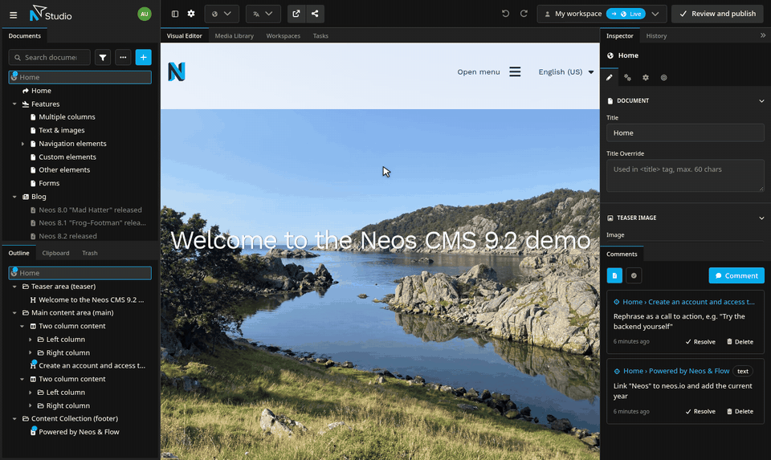
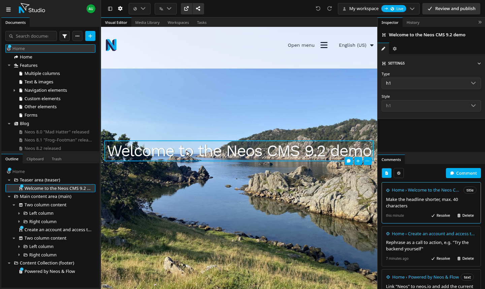

# Beromir.BackendComments

Leave notes on your content in **Neos Studio** and let your agent work through
them. Select an element in the preview, optionally one of its properties, and
write what should change. An agent connected as you through the
[Neos MCP server](https://github.com/medienreaktor/Neos.Mcp) lists your open
comments, makes the changes and resolves them.

The comments are for you and your agent, not for website visitors, and they
live in the backend like comments in a design tool. There are no replies or
threads: the agent answers in its own chat.

> Requires **Neos Studio** 2.5 or later (`medienreaktor/neos-studio`, installed
> with this package). The package adds nothing to the classic Neos UI.



## What you get in Studio

- **Comment button** on the element handle in the preview and in the node
  context menus. It opens the comment dialog for the element, where you can
  pick the property the comment is about.
- **Comments panel** with your comments on the current page or on all pages,
  open or resolved. Comment on the selected element, resolve, reopen, delete,
  and jump to the commented element.
- **Badges** in the document tree and the outline on nodes with open comments.
  A page counts the comments on its content as well.



## How an agent works through your comments

1. `listComments` with `filterByStatus: OPEN`, limited to one page with
   `filterByDocumentNodeAggregateId` if you ask about one.
2. For each comment, read the node with `getNode` in the comment's workspace
   and dimension space point, to see what you saw.
3. Make the change in that workspace (usually your personal one), on the
   property the comment names if it names one.
4. `resolveComment` once it's done. The answer, or a question back, goes to
   the agent's chat with you, since comments have no replies.

An agent can also leave comments for you with `createComment`, for example
review notes on a page. They show up in your Comments panel.

## Compatibility

| This package | Neos Studio | Neos | PHP  |
| ------------ | ----------- | ---- | ---- |
| 1.x          | ^2.5        | ^9.2 | ^8.4 |

The package needs Neos Studio 2.5 for its plugin dialogs and the actions on
the element handle.

## Installation

Require the package in your site package:

```bash
composer require --no-update beromir/neos-backend-comments
```

Then run `composer update` in your project root, create the comments table
and flush the Flow caches:

```bash
./flow doctrine:migrate
./flow flow:cache:flush
```

The package adds its labels to the Neos translation bundle. If Studio shows
English labels for another interface language, flush that bundle once:

```bash
./flow flow:cache:flushone Neos_Neos_XliffToJsonTranslations
```

To offer the comments as MCP tools, install
[`medienreaktor/neos-mcp`](https://github.com/medienreaktor/Neos.Mcp) as well.

## Privacy

Comments are private: you only see your own, and so does an agent that acts
as you. Every operation is limited to the caller's comments; another user's
comment is a 404, like one that doesn't exist. Administrators don't see them
either.

The comments are kept in their own table (`beromir_backendcomments_comment`),
not in the content repository, so commenting never creates changes to publish.

## MCP tools and API

The operations are part of the Neos API (`Neos.OpenApi.FlowAdapter.apis.neos`).
Studio calls them with its own token, and Neos.Mcp offers them as tools:

| Tool / operation | Request                                          | Scope             |
| ---------------- | ------------------------------------------------ | ----------------- |
| `listComments`   | `GET /api/cr/{cr}/comments`                      | `comments.read`   |
| `getComment`     | `GET /api/cr/{cr}/comments/{commentId}`          | `comments.read`   |
| `createComment`  | `POST /api/cr/{cr}/comments`                     | `comments.update` |
| `resolveComment` | `POST /api/cr/{cr}/comments/{commentId}/resolve` | `comments.update` |
| `reopenComment`  | `POST /api/cr/{cr}/comments/{commentId}/reopen`  | `comments.update` |
| `deleteComment`  | `DELETE /api/cr/{cr}/comments/{commentId}`       | `comments.update` |

The scopes are granted to `Neos.Neos:AbstractEditor`, so every editor can
comment, and an agent gets them when the editor allows it on the consent page.

`listComments` returns the comments newest first. Its filters combine:
`filterByStatus` (`OPEN` or `RESOLVED`), `filterByNodeAggregateId` (a list of
nodes) and `filterByDocumentNodeAggregateId` (a page and the content on it).

A comment records where it was written:

- the node (`nodeAggregateId`), its label and its type,
- the page it is on (`documentNodeAggregateId`) and the page's title,
- the property it is about (`propertyName`, `null` for the whole element),
- the workspace and dimension space point the author saw the node in.

The labels are what the node looked like when the comment was written; the
node itself may have changed since.

`createComment` takes the node, the text and, optionally, the workspace (live
if omitted), the dimension space point (the default one if omitted) and the
property. An empty text or a property the node type doesn't have is a 422, a
node the caller may not read a 404.

## Development

The bundle is prebuilt into `Resources/Public/Plugin/` and committed. To
rebuild it:

```bash
cd Resources/Private/Plugin
npm ci
npm run build        # emits Resources/Public/Plugin/{plugin.js,plugin.css}
```

Then flush the Flow caches and reload Studio. `npm run dev` rebuilds on
change.

The plugin API types come from `@medienreaktor/neos-studio`, which is still at
2.2.0 on npm. `src/studio-2.5.d.ts` declares the 2.4/2.5 additions the plugin
uses (`dialogs.open()`, `handle` on node actions); remove it once the package
publishes them.

The functional tests need a Neos distribution with a MariaDB or MySQL
database in the `Testing` context (on other databases they skip themselves):

```bash
FLOW_CONTEXT=Testing bin/phpunit -c Build/BuildEssentials/PhpUnit/FunctionalTests.xml \
    Packages/Plugins/Beromir.BackendComments/Tests/Functional
```

## License

Released under the GNU General Public License, version 3 or later, see
[LICENSE](LICENSE).
